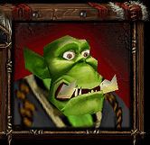
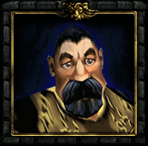
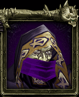

<div align="center">

&nbsp;
&nbsp;


# Unit War3 Claude

**Работник из Warcraft III в панели Claude Code.**
Пока Claude думает, работник берётся за дело. Когда ответ готов, он докладывает.
Когда нужно твоё решение, он зовёт хозяина.

Мод (плагин) для Claude Code · русская озвучка · Windows и macOS

</div>

---

## Что это

Unit War3 Claude открывает в Claude Code небольшую панель с портретом юнита из Warcraft III.
Работник следит за ходом Claude и отвечает оригинальными репликами из игры:

| Что происходит в Claude Code | Что делает работник |
| --- | --- |
| Claude начал работать над запросом | «Работаю» и реплика вроде «Сделаю.» |
| Claude закончил ответ | «Дело сделано» и реплика о завершении |
| Claude ждёт разрешения или задаёт вопрос | «Жду твоего ответа» и окрик «Чё надо, хозяин?» |
| Запрос оборвался с ошибкой | «Нужна помощь» и предсмертный хрип |
| Ты нажал «Позвать» | Случайная реплика, как при клике по юниту в игре |

Полоска под портретом меняет цвет вместе с состоянием, а последняя реплика видна текстом.

## Персонажи

| | Персонаж | Берётся за дело | Закончил |
| --- | --- | --- | --- |
|  | **Орк-раб** | «Сделаю.», «Хо-ро-шо.», «Почему бы нет?» | «Дело сделано!» |
|  | **Крестьянин** | «Угу.», «Хорошо.», «Опять работа?!» | «Работа не волк, в лес не убежит.» |
|  | **Послушник** | «Да, повелитель.», «Да свершится предначертанное.» | «Постройка завершена.», «Исследование завершено.» |

По клику каждый отвечает своим набором: от «Ты что ли король? А я за тебя не голосовал!» до «Нужно построить зиккурат!».

---

## Установка

Нужен Claude Code: приложение Claude для компьютера (вкладка Code) или Claude Code в терминале.
Выбери любой способ, результат одинаковый.

### Способ 1. Через интерфейс приложения Claude

1. Открой вкладку **Code** в приложении Claude.
2. Нажми **+** рядом с полем ввода и выбери **Plugins**.
3. Нажми **Add marketplace** и введи:
   ```
   Maxim1Up/unit-war3-claude
   ```
4. Нажми **Add plugin** и выбери **unit-war3-claude**.
5. Открой новую сессию: панель работника появится сама.

### Способ 2. Командой внутри Claude Code в терминале

Набери в поле ввода Claude Code:

```
/plugin install unit-war3-claude --marketplace Maxim1Up/unit-war3-claude
```

На вопрос `Add marketplace?` ответь `y`, затем выбери область **user**, чтобы мод работал во всех проектах.

### Способ 3. Одной командой из обычного терминала

```bash
claude plugin install unit-war3-claude --marketplace Maxim1Up/unit-war3-claude
```

Команда сама добавит маркетплейс и установит мод для твоего пользователя.
Он загрузится в следующей сессии Claude Code, в терминале и в приложении.

### Способ 4. Из локальной копии

Подходит, если хочешь править мод под себя.

```bash
git clone https://github.com/Maxim1Up/unit-war3-claude.git
```

```bash
claude plugin marketplace add ./unit-war3-claude
```

```bash
claude plugin install unit-war3-claude@unit-mods
```

Такой мод читается прямо из папки: правишь файлы, затем открываешь новую сессию
или вводишь `/reload-plugins` в терминальной сессии.

---

## Как пользоваться

Панель **Unit War3 Claude** открывается сама в начале каждой сессии.
Если ты её закрыл, верни командой `/unit`.

В панели есть:

- **Позвать**, **Звук: вкл./выкл.** и **Проверить**. Последняя кнопка проигрывает реплику «дело сделано», чтобы проверить звук.
- **Персонаж**: орк-раб, крестьянин или послушник. Выбор запоминается.
- **Настройки**:
  - **Случайный при запуске**. Каждая новая сессия начинается со случайного персонажа, не того, что был в прошлый раз. Настройка запоминается.
  - **Отключить в этой сессии**. Работник замолкает до конца сессии, в панели остаётся кнопка «Включить». В новой сессии он снова на месте.

### Команды

| Команда | Что делает |
| --- | --- |
| `/unit` | Открыть панель |
| `/unit орк` | Выбрать орка-раба |
| `/unit крестьянин` | Выбрать крестьянина |
| `/unit послушник` | Выбрать послушника (`/unit нежить` тоже работает) |
| `/unit звук` | Включить или выключить реплики |
| `/unit случайный` | Включить или выключить случайного персонажа при запуске |
| `/unit выкл` | Отключить работника до конца этой сессии |
| `/unit вкл` | Вернуть работника в этой сессии |

Английские варианты тоже понимаются: `peon`, `peasant`, `acolyte`, `mute`, `random`, `off`, `on`.

---

## Включить, выключить, обновить, удалить

В приложении: **+** → **Plugins**, переключатель у **unit-war3-claude**.

Или командами:

```bash
claude plugin disable unit-war3-claude
```

```bash
claude plugin enable unit-war3-claude
```

```bash
claude plugin update unit-war3-claude
```

```bash
claude plugin uninstall unit-war3-claude
```

Изменения подхватит новая сессия Claude Code.

---

## Где что работает

| Где | Панель | Звук |
| --- | --- | --- |
| Приложение Claude на Windows, вкладка Code | Портрет и кнопки | Есть, через встроенный в Windows проигрыватель |
| Приложение Claude на macOS, вкладка Code | Портрет и кнопки | Есть, через `afplay` |
| Claude Code в терминале | Компактная текстовая панель | Есть на Windows и macOS |
| Linux | Панель работает | Нет: у Claude Code там нет проигрывателя |

Обычный чат Claude (не вкладка Code) моды не поддерживает.

---

## Как устроено

```
.claude-plugin/
  plugin.json        имя, версия и описание мода
  marketplace.json   делает этот репозиторий маркетплейсом с одним модом
hooks/
  hooks.json         указывает на модуль с хуками
  register.tsx       вся логика: панель, реакции, звук, настройки, команда /unit
types/index.d.ts     типы состояния, которое панель хранит в сессии
tests/unit.test.ts   тесты панели, выбора персонажа и настроек
assets/              портреты и реплики трёх персонажей
```

Мод слушает события Claude Code: начало и конец хода, запрос разрешения, вопрос пользователю.
Выбор персонажа, звук и флажок «случайный» хранятся в хранилище мода и переживают перезапуск.
Отключение на сессию хранится только в самой сессии.

### Разработка

```bash
claude plugin validate .
```

```bash
claude plugin test .
```

---

## Авторские права

Код мода распространяется по лицензии [MIT](LICENSE).

Реплики и портреты из папки `assets` — оригинальные материалы Warcraft III © Blizzard Entertainment.
Они взяты из открытых паков проекта [PeonPing](https://github.com/PeonPing/og-packs)
(русская озвучка собрана [maksimfedin](https://github.com/maksimfedin), лицензия паков CC-BY-NC-4.0)
и на них не распространяется лицензия MIT. Только для некоммерческого использования.
Подробности в [assets/SOURCES.txt](assets/SOURCES.txt).

Проект не связан с Blizzard Entertainment и Anthropic.
